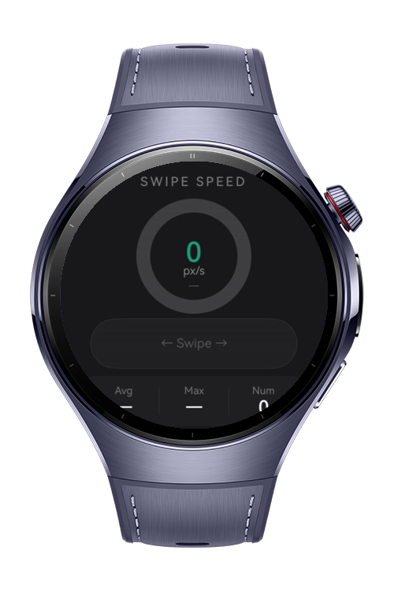
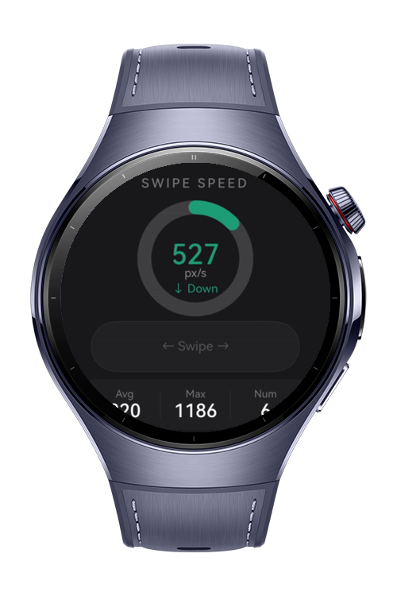
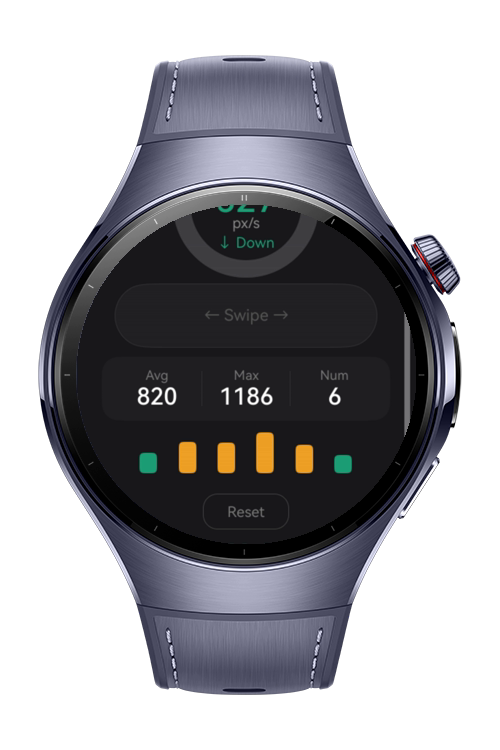

> **Note:** To access all shared projects, get information about environment setup, and view other guides, please visit [Explore-In-HMOS Index](https://github.com/Explore-In-HMOS/hmos-index).

# How to Measure Swipe Speed
A wearable app built with ArkTS + ArkUI that measures swipe speed in real time, detects direction, and visualizes results with a gauge, color feedback, and basic swipe statistics.
# Preview

<div>
  
  
  

</div>

# Use Cases
* **Real-time speed measurement**: Calculates swipe velocity in px/s using PanGesture
* **Direction detection**: Identifies four directions — left, right, up, and down
* **Gauge indicator**: Displays speed visually with a circular progress ring
* **Color coding**: Green (slow) → Yellow (medium) → Red (fast)
* **Statistics tracking**: Provides average speed, maximum speed, and total swipe count
* **Mini bar chart**: Shows a visual history of the last 10 swipes
* **Reset functionality**: Clears all recorded data

# Technology

## Stack
**Languages**: ArkTS

**Frameworks**: HarmonyOS SDK 5.1.0(18)

**Tools**: DevEco Studio Vers 5.1.0.842

**Libraries**: '@kit.AbilityKit', '@kit.PerformanceAnalysisKit', '@kit.ArkUI'

# Directory Structure
```
 
 │   ├── entryability/
 │   │   └── EntryAbility.ets  # App lifecycle
 │   └── pages/
 │       └── Index.ets        # Main UI component and logic

```
# Constraints and Restrictions

## Supported Device
- Huawei Watch 5

# License

Swipe Speed Meter is distributed under the terms of the MIT License.

See the [LICENSE](./LICENSE) for more information.